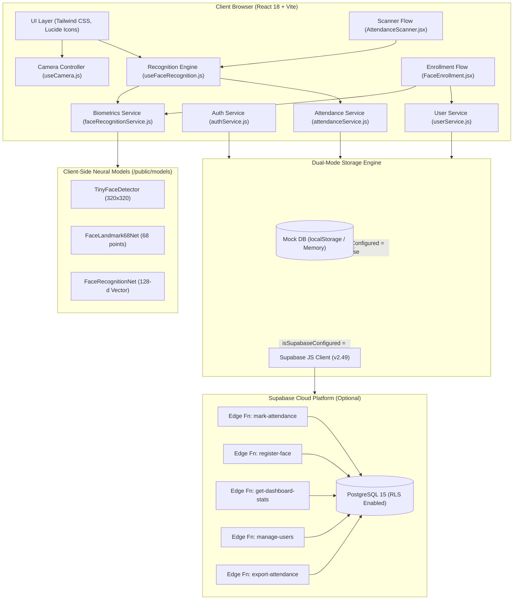
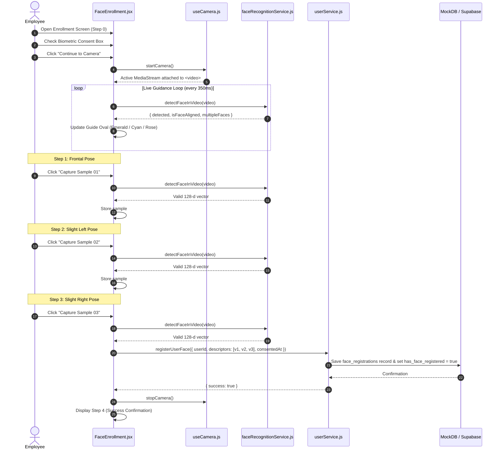
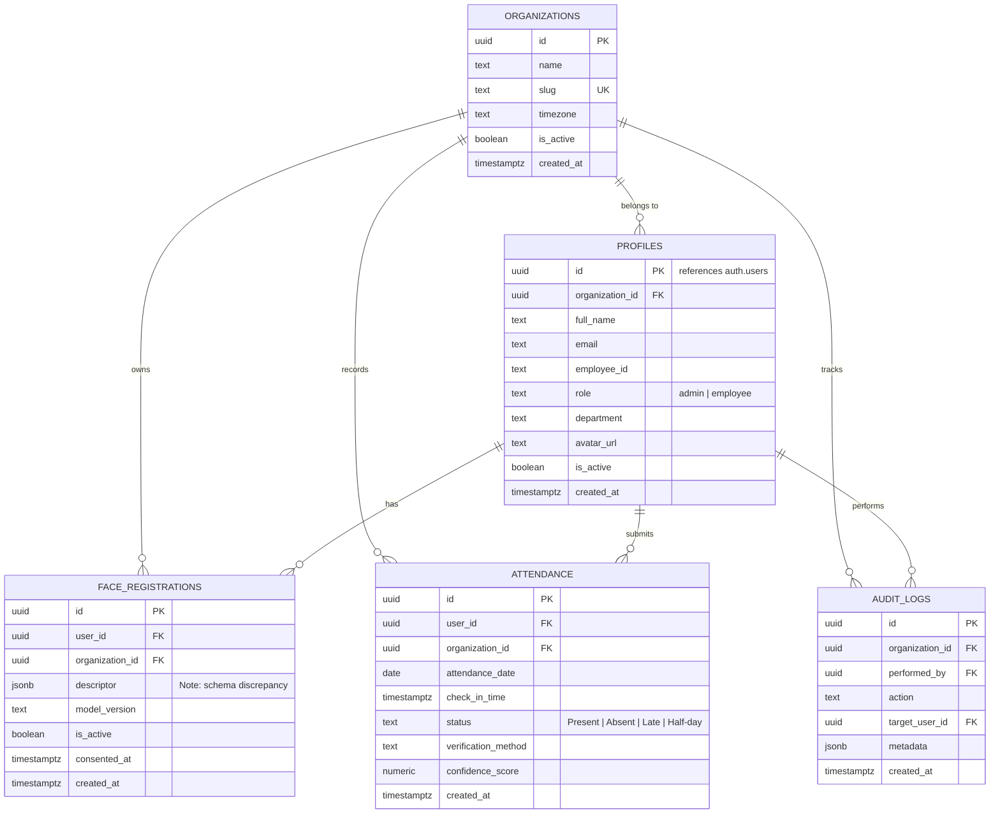

# FaceTrack System Architecture

This document provides a comprehensive architectural specification of the FaceTrack Real-Time Face Recognition-Based Smart Attendance Management System.

---

## 1. High-Level Architecture Overview

FaceTrack operates as a single-page progressive web application with a dual-mode data layer:
1. **Mock-Data Mode (Current Baseline)**: Fully local, in-memory/localStorage persistent execution enabling end-to-end face enrollment, camera tracking, and biometric attendance without requiring a live backend.
2. **Supabase Production Mode**: Integrates with Supabase PostgreSQL (Row-Level Security) and Deno-based Supabase Edge Functions for authenticated cloud-hosted biometric attendance.

---

## 2. Frontend Subsystems

### 2.1 Camera Lifecycle Management ([`useCamera.js`](file:///c:/Users/AVIRAL%20JAIN/Documents/SMART%20ATTENDANCE%20SYSTEM/src/hooks/useCamera.js))

The camera controller provides rock-solid stream acquisition with explicit hardware renegotiation protections:
- **Fast-Path Stream Reuse**: If `streamRef.current` is active and healthy on the target device, `startCamera()` verifies `<video>` attachment and playback without calling `navigator.mediaDevices.getUserMedia()`.
- **Request Cancellation**: Uses a monotonic `requestIdRef` counter to discard streams from slow or obsolete `getUserMedia()` invocations.
- **Auto-Attachment Synchronizer**: A dedicated DOM effect ensures that when the `<video>` element mounts or re-renders while `isActive` is true, `videoRef.current.srcObject` is wired up and playing.
- **Deterministic Teardown**: `stopCamera()` and component unmount invoke `track.stop()` across all active media tracks.

### 2.2 Neural Face Recognition Engine ([`faceRecognitionService.js`](file:///c:/Users/AVIRAL%20JAIN/Documents/SMART%20ATTENDANCE%20SYSTEM/src/services/faceRecognitionService.js))

Biometric processing executes via `@vladmandic/face-api` using local neural weights stored in `/public/models`:
1. **Model Suite**:
   - `tinyFaceDetector`: Real-time face boundary localization (`inputSize: 320`, `scoreThreshold: 0.45`).
   - `faceLandmark68Net`: 68-point 2D facial landmark extraction.
   - `faceRecognitionNet`: ResNet-34 based deep network projecting faces into a normalized 128-dimensional Euclidean space.
2. **Descriptor Validation**:
   - Every candidate vector must satisfy `isValidDescriptor()`: exactly 128 finite numeric values.
3. **Head Pose Alignment Check**:
   - Compares eye-to-nose horizontal symmetry distances (`symmetryRatio = distToRight / distToLeft`).
   - Frontal pose requires ratio between `0.55` and `1.82`.
4. **Distance & Confidence Calculation**:
   - Euclidean distance: $d = \sqrt{\sum_{i=1}^{128} (A_i - B_i)^2}$
   - Calibrated threshold: `DEFAULT_MATCH_THRESHOLD = 0.55`.
   - Confidence mapping: $C = \max(0, \min(1, 1 - \frac{d}{1.5 \times 0.55}))$.
5. **Kiosk Multi-Candidate Identification**:
   - Evaluates live descriptor against all active organization employees.
   - Requires best match $d \le 0.55$.
   - Enforces runner-up margin: $d_{\text{runner-up}} - d_{\text{best}} \ge 0.05$ to reject ambiguous matches.

### 2.3 Biometric Enrollment ([`FaceEnrollment.jsx`](file:///c:/Users/AVIRAL%20JAIN/Documents/SMART%20ATTENDANCE%20SYSTEM/src/components/face-recognition/FaceEnrollment.jsx))

### 2.4 Attendance Scanning & Deduplication ([`useFaceRecognition.js`](file:///c:/Users/AVIRAL%20JAIN/Documents/SMART%20ATTENDANCE%20SYSTEM/src/hooks/useFaceRecognition.js))

- **2-Consecutive-Match Debounce**: Prevents momentary classification spikes from recording attendance. Identity must match consecutively across at least two frame evaluations.
- **Strict Anti-Duplicate Locking**:
  - In targeted employee mode: locks `attendanceSubmittedRef = true` and `hasCompletedAttendanceRef = true`. Scanner reset retains the submission lock.
  - In kiosk mode: uses `kioskAttendanceLockMapRef` Set to prevent duplicate check-ins for the same employee during the kiosk session.

---

## 3. Data Storage & Schema Architecture

### 3.1 Database Schema (PostgreSQL 15 / Supabase)

Defined in [`supabase/migrations/20261102_initial_schema.sql`](file:///c:/Users/AVIRAL%20JAIN/Documents/SMART%20ATTENDANCE%20SYSTEM/supabase/migrations/20261102_initial_schema.sql):

### 3.2 Dual-Mode Engine Implementation

| Layer | Mock-Mode (`isSupabaseConfigured = false`) | Supabase Mode (`isSupabaseConfigured = true`) |
| :--- | :--- | :--- |
| **Authentication** | In-memory session key + mock profiles in localStorage | `supabase.auth.signInWithPassword()` / `signUp()` |
| **Biometric Vectors** | `mockDatabase.js` (`db.face_registrations`) | Table `public.face_registrations` / Edge Fn `register-face` |
| **Attendance** | `mockDatabase.js` (`db.attendance`) | Table `public.attendance` / Edge Fn `mark-attendance` |
| **Audit Logs** | `mockDatabase.js` (`db.audit_logs`) | Table `public.audit_logs` |
| **Organization Boundaries** | Filtered by `organization_id: 'org-lexcorp-001'` | Enforced by PostgreSQL Row-Level Security (RLS) |

---

## 4. Edge Functions Architecture

Located under [`supabase/functions/`](file:///c:/Users/AVIRAL%20JAIN/Documents/SMART%20ATTENDANCE%20SYSTEM/supabase/functions/):

1. **`mark-attendance`**:
   - Validates caller JWT via `supabase.auth.getUser()`.
   - Checks if user has an active row in `face_registrations`.
   - Computes local date using `Asia/Kolkata` timezone.
   - Enforces unique daily attendance via `unique_user_daily_attendance` constraint (`code: 23505`).
2. **`register-face`**:
   - Requires `biometricConsent = true`.
   - Deactivates previous active records for the user (`is_active: false`).
   - Inserts newly captured descriptor(s).
3. **`get-dashboard-stats`**:
   - Aggregates daily check-in counts for admin or user history for employee.
4. **`manage-users`**:
   - Admin-restricted endpoint to list organization users or toggle active status.
5. **`export-attendance`**:
   - Generates CSV report stream of organization attendance records.
