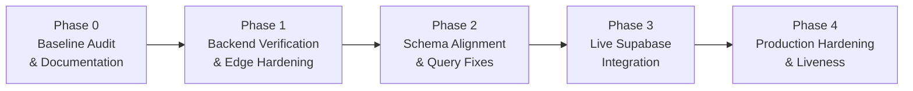

# FaceTrack Strategic Development Roadmap

This roadmap establishes the phased engineering plan to transition FaceTrack from its current stable mock-mode milestone to a production-grade, cryptographically verified biometric attendance system.

---

## Roadmap Phases Overview

---

## Phase 0: System Audit & Documentation (Current Phase)

### Objective
Establish the project documentation system, audit existing architecture, inspect confirmed defects, and establish reproducible test baselines without modifying application code.

### Deliverables
- [x] Run and record full automated test suite (`npm test`): 102 passing tests.
- [x] Run and record production Vite bundle build (`npm run build`): 0 errors.
- [x] Investigate 5 flagged architectural concerns:
  - Direct attendance insertion fallback.
  - Default confidence values.
  - Hardcoded dashboard statistics.
  - `descriptor` vs `descriptors` schema inconsistency.
  - Lack of backend biometric verification.
- [x] Create project documentation:
  - [`CHANGELOG.md`](file:///c:/Users/AVIRAL%20JAIN/Documents/SMART%20ATTENDANCE%20SYSTEM/CHANGELOG.md)
  - [`docs/ARCHITECTURE.md`](file:///c:/Users/AVIRAL%20JAIN/Documents/SMART%20ATTENDANCE%20SYSTEM/docs/ARCHITECTURE.md)
  - [`docs/PROJECT_PROGRESS.md`](file:///c:/Users/AVIRAL%20JAIN/Documents/SMART%20ATTENDANCE%20SYSTEM/docs/PROJECT_PROGRESS.md)
  - [`docs/ROADMAP.md`](file:///c:/Users/AVIRAL%20JAIN/Documents/SMART%20ATTENDANCE%20SYSTEM/docs/ROADMAP.md)
  - [`docs/TEST_RESULTS.md`](file:///c:/Users/AVIRAL%20JAIN/Documents/SMART%20ATTENDANCE%20SYSTEM/docs/TEST_RESULTS.md)
- [x] Maintain separate branch `audit-phase-0-baseline` without touching `main`.

---

## Phase 1: Backend Face Verification & Edge Function Hardening (Recommended Next Step)

### Objective
Eliminate client-trust vulnerabilities in attendance marking. Transition the system from client-asserted confidence to trusted backend vector comparison.

### Scope of Work
1. **Edge Function `mark-attendance` Upgrade**:
   - Require client to submit the live 128-dimensional biometric vector captured from the camera (`liveDescriptor: number[]`).
   - Edge Function loads the user's active enrolled descriptors from `face_registrations`.
   - Edge Function computes Euclidean distance and verification confidence on the server.
   - Server enforces `distance <= 0.55` threshold before permitting database insertion into `attendance`.
   - Eliminate default `confidence_score: matchConfidence || 0.95`.
2. **Remove Insecure Client Fallback**:
   - Remove the direct table insertion fallback in [`src/services/attendanceService.js`](file:///c:/Users/AVIRAL%20JAIN/Documents/SMART%20ATTENDANCE%20SYSTEM/src/services/attendanceService.js) (lines 63–78).
   - If the Edge Function rejects or fails, return an explicit error and fail closed.
   - Adjust PostgreSQL RLS policies on table `public.attendance` so regular clients can only `SELECT` their own attendance, while only the Edge Function (service role) can `INSERT`.
3. **Payload Signature / Tamper Protection**:
   - Require authenticated user JWT on all Edge Function calls.
   - Validate that the caller's JWT user ID matches the target user ID (unless an authorized Admin Kiosk is submitting).

### Acceptance Criteria
- A curl call to `mark-attendance` with `{ "matchConfidence": 0.99 }` without a valid matching biometric vector is rejected with `400 Bad Request` or `403 Verification Failed`.
- Only a live descriptor matching enrolled templates within threshold can mark attendance.
- Direct `supabase.from('attendance').insert(...)` from browser client is blocked by RLS.

---

## Phase 2: Schema Harmonization & Service Query Alignment

### Objective
Resolve the database schema inconsistencies between `descriptor` (singular) and `descriptors` (plural) and fix client dashboard property mismatches.

### Scope of Work
1. **Schema Standardization**:
   - Decide on schema convention: either store multiple sample vectors as `descriptors JSONB NOT NULL` (JSON array of 128-d arrays) or standardize on single vectors per row with a sequence index.
   - Update [`supabase/migrations/20261102_initial_schema.sql`](file:///c:/Users/AVIRAL%20JAIN/Documents/SMART%20ATTENDANCE%20SYSTEM/supabase/migrations/20261102_initial_schema.sql) and create an explicit migration.
2. **Query Alignment in [`src/services/userService.js`](file:///c:/Users/AVIRAL%20JAIN/Documents/SMART%20ATTENDANCE%20SYSTEM/src/services/userService.js)**:
   - Fix `getUserFaceDescriptors`: Unpack stored multi-descriptor JSONB arrays properly before running `isValidDescriptor`.
   - Fix `getOrganizationBiometricRegistry`: Correct column selection to match the standardized schema name.
3. **Dashboard Metrics Cleanup**:
   - Align property names between [`supabase/functions/get-dashboard-stats/index.ts`](file:///c:/Users/AVIRAL%20JAIN/Documents/SMART%20ATTENDANCE%20SYSTEM/supabase/functions/get-dashboard-stats/index.ts) and [`src/services/attendanceService.js`](file:///c:/Users/AVIRAL%20JAIN/Documents/SMART%20ATTENDANCE%20SYSTEM/src/services/attendanceService.js) (`totalEmployees` vs `totalUsers`).
   - Fix falsy `0` fallback in [`src/pages/admin/Dashboard.jsx`](file:///c:/Users/AVIRAL%20JAIN/Documents/SMART%20ATTENDANCE%20SYSTEM/src/pages/admin/Dashboard.jsx) (`metrics?.presentToday ?? 0`).
   - Remove hardcoded static card values (`onLeaveToday`, `weeklyOff`, `holiday`).

### Acceptance Criteria
- `userService.getUserFaceDescriptors()` and `userService.getOrganizationBiometricRegistry()` return correct vectors in both mock and Supabase modes.
- `Dashboard.jsx` accurately displays `0 Checked In` when present count is zero.

---

## Phase 3: Live Supabase Integration & Dual-Mode Verification

### Objective
Connect the application to a live Supabase project, execute migrations, deploy Edge Functions, and verify end-to-end operation with both cloud and mock environments.

### Scope of Work
1. Connect live Supabase project credentials in `.env`.
2. Apply database migrations to the remote Supabase PostgreSQL database.
3. Deploy all 5 Edge Functions using Supabase CLI.
4. Verify user registration, face enrollment, biometric verification, and attendance check-in against the live Supabase instance.
5. Verify that offline / mock fallback continues to function seamlessly when live credentials are absent.

### Acceptance Criteria
- New employee can register, enroll, and mark attendance against live Supabase database.
- Audit trail correctly recorded in `public.audit_logs`.
- Dual-mode automatic toggle operates without code modifications.

---

## Phase 4: Production Hardening, Liveness Detection & Observability

### Objective
Enhance biometric security with liveness verification, rate limiting, and observability.

### Scope of Work
1. **Passive Liveness / Blink Detection**: Prevent static photograph spoofing by requiring head movement or eye blink during capture.
2. **Rate Limiting & Anti-Bruteforce**: Limit verification attempts per terminal to prevent automated brute-force attempts.
3. **Audit Trail Verification**: Verify that all biometric actions (registration, consent withdrawal, check-in) generate structured tamper-evident audit logs.
